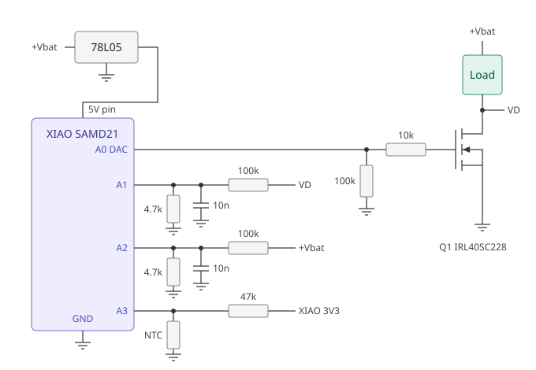

# XIAO SAMD21 – Adjustable Low-Side Linear Load Regulator

Keeps a load at **12 V by default** from a battery that can rise up to **20 V**.
The setpoint can be changed at runtime over the same Serial (USB) port used for status output.
A Seeed XIAO SAMD21 measures the battery and drain voltages and drives the gate of
an N-channel MOSFET (IRL40SC228) directly from its DAC. The MOSFET sits in the
negative lead of the load (low side) and drops the excess voltage.

When the battery is below the setpoint, the MOSFET turns fully on and the load gets the
battery voltage minus a few mV.

```
V_load = V_bat − V_drain
```

---

## Schematic



Both **VD** labels are the same net (Q1 drain). All ground symbols go to BAT– at one
point near Q1's source. Not shown: C3/C4 at the 78L05, and the flyback diode across
an inductive load. 

---

## Quick reference: Serial commands

Connect with any serial terminal (Arduino Serial Monitor, PuTTY, screen, …) at
**115200 baud**, line ending **Newline** or **CR+LF**.

| Command | Example | Reply | Action |
|---|---|---|---|
| `V<volts>` | `V11.5` | `OK Vset=11.50` | Set load voltage (2.50–18.00 V) |
| `V` | `V` | `Vset=11.50` | Show current setpoint |
| `ON` | `ON` | `OK ON` | Enable output |
| `OFF` | `OFF` | `OK OFF` | Disable output, Q1 held off |
| `P1` | `P1` | `OK P1` | Status print every 250 ms on |
| `P0` | `P0` | `OK P0` | Status print off (for scripts) |
| `?` | `?` | status + help | Show status, commands and range |

Default after power-up or reset: **12.00 V, ON, P1**.

---

## Hardware

### Bill of materials

| Ref | Part | Value / type | Notes |
|---|---|---|---|
| U1 | Seeed XIAO SAMD21 | — | Controller, DAC on A0 |
| U2 | 78L05 | 5 V LDO, max 30 V in | Powers the XIAO via its 5V pin; needs V_bat ≥ ~6.7 V |
| Q1 | Infineon IRL40SC228 | N-MOSFET, 40 V, D2PAK-7 | Needs a heatsink |
| R_PD | Resistor | 100 kΩ | A0 → GND (DAC side), keeps Q1 off when DAC is not driving |
| R_G | Resistor | 10 kΩ | A0 → gate, isolates DAC from gate capacitance |
| R1, R3 | Resistor | 100 kΩ, 0.1–1 % | Top of the drain and battery dividers |
| R2, R4 | Resistor | 4.7 kΩ, 0.1–1 % | Bottom of the drain and battery dividers |
| C1, C2 | Capacitor | 10 nF | ADC filter at A1 and A2 |
| R5 | Resistor | 47 kΩ | NTC pull-up from the XIAO 3V3 pin (output) |
| NTC | Thermistor | 10 kΩ, B = 3950 | On Q1's heatsink (optional) |
| C3 | Capacitor | 330 nF | 78L05 input |
| C4 | Capacitor | ≥ 10 µF | 78L05 output |
| D1 | Diode | Schottky or fast diode | Across load, only for inductive loads |

### Wiring

| XIAO pin | SAMD21 | Connect to |
|---|---|---|
| A0 / D0 | PA02 (DAC) | 100 kΩ A0 → GND; 10 kΩ A0 → Q1 gate |
| A1 / D1 | PA04 (ADC) | Divider: 100 kΩ from Q1 drain, 4.7 kΩ to GND, 10 nF to GND |
| A2 / D2 | PA10 (ADC) | Divider: 100 kΩ from +Vbat, 4.7 kΩ to GND, 10 nF to GND |
| A3 / D3 | PA11 (ADC) | 47 kΩ from XIAO 3V3 pin; NTC 10 kΩ to GND (optional) |
| 5V | — | 78L05 output |
| 3V3 | — | Output of the XIAO's onboard regulator: only for the NTC pull-up, do not feed it |
| GND | — | BAT– at the star point near Q1's source |

**Power stage**

- Load between **+Vbat** and **Q1 drain**.
- Q1 **source** to **BAT–**.
- If the load is inductive, put D1 across it (cathode toward +Vbat).
- The load's negative terminal must connect **only** to Q1's drain. Any other connection
  to ground (shared signal ground, metal chassis) bypasses Q1 and breaks the regulation.

**Grounding:** join all signal grounds (XIAO, dividers, NTC, 78L05) at one point near Q1's
source, so the load current does not flow through the measurement ground.

---

## Design values

### Gate network

| | Value |
|---|---|
| Max gate voltage | **3.3 V** (no divider: the pull-down is on the DAC side, the gate draws no DC current) |
| Turn-off without DAC | (10 kΩ + 100 kΩ) × ~20 nF ≈ **2.2 ms** |
| Gate filter (DAC driving) | 10 kΩ × ~20 nF ≈ **0.2 ms** |
| DAC load | 100 kΩ, well within the DAC's drive capability |

Putting the pull-down on the DAC side of the series resistor gives the gate the full
DAC voltage while still discharging it through 110 kΩ when the DAC is not driving.

### Voltage dividers (internal 1.0 V ADC reference)

| | Value |
|---|---|
| Ratio | (100 k + 4.7 k) / 4.7 k = **22.28** |
| ADC voltage at 20 V input | ≈ **0.90 V** (10 % headroom) |
| Resolution | ≈ **5.4 mV** per LSB at the input (12-bit) |
| Current per divider | ≈ 0.19 mA at 20 V |
| Filter time constant | ≈ 4.5 kΩ × 10 nF ≈ 45 µs |

The ADC pin reaches 3.3 V only at about 70 V input, so the dividers also give good
overvoltage margin.

---

## Firmware

Sketch: `xiao_lowside_regulator.ino` (Arduino needs it in a folder of the same name: `xiao_lowside_regulator/`) (Arduino IDE, Seeed SAMD board package,
board "Seeeduino XIAO").

### How it works

1. Every `LOOP_US` microseconds, read V_bat (A2) and V_drain (A1), averaged over
   `OVERSAMPLE` samples.
2. Compute `V_load = V_bat − V_drain` and the error to the setpoint `vTarget`.
3. A PI controller adjusts the DAC value on A0.
4. Protection logic overrides the controller when needed.

### Settings

| Constant | Default | Meaning |
|---|---|---|
| `V_DEFAULT` | 12.00 V | Setpoint after power-up |
| `V_SET_MIN` / `V_SET_MAX` | 2.50 / 18.00 V | Range accepted by the `V` command |
| `V_OVER_MARGIN` | 1.00 V | Gate is pulled down fast above setpoint + this |
| `LOOP_US` | 1300 µs | Control period, must be longer than one loop pass |
| `KI_UP` | 2.0 | Integral step per volt per loop when raising the gate |
| `KI_DOWN` | 2.0 | Integral step per volt per loop when lowering the gate |
| `KP` | 8.0 | Proportional gain, DAC counts per volt |
| `INTEG_START` | 250 | Start value (~0.8 V), below the gate threshold |
| `VD_SAT` | 0.15 V | Drain below this = Q1 fully on, stops integrator wind-up |
| `OVERSAMPLE` | 8 | ADC samples per reading |
| `T_MAX_C` / `T_RESUME_C` | 90 / 75 °C | Over-temperature shutdown and restart |
| `USE_NTC` | 1 | Set to 0 if no NTC is fitted |
| `CAL_VBAT`, `CAL_VDRAIN` | 1.000 / 1.060 | Calibration factors |

The ADC is set to the internal 1.0 V reference. The DAC stays on AVCC (3.3 V);
with a 1 V DAC reference the gate could never reach the threshold.

### Serial commands (115200 baud, end each command with Enter)

| Command | Action |
|---|---|
| `V<volts>` | Set the load voltage, e.g. `V11.5` or `V 13` (2.50–18.00 V) |
| `V` | Show the current setpoint |
| `ON` / `OFF` | Enable / disable the output (OFF holds Q1 off) |
| `P1` / `P0` | Periodic status print on / off |
| `?` | Show status, command list and setpoint range |

Commands are case-insensitive. Replies start with `OK` or `ERR`, which makes the
interface easy to drive from a script or another controller.
The setpoint is kept in RAM only: after power-up or reset it is always 12.00 V.
If the battery is below the requested setpoint, the load simply gets the battery voltage.

### Example session

```
> V
Vset=12.00
> V 13.2
OK Vset=13.20
> v25
ERR range 2.50 .. 18.00 V
> P0
OK P0
> ?
Vset=13.20 ON Vbat=14.08 Vd=0.87 Vload=13.21 DAC=655 T=38.9 dt_max=1040 overruns=0
Commands: V<volts>, V, ON, OFF, P1, P0, ?
Setpoint range: 2.50 .. 18.00 V
> OFF
OK OFF
> hello
ERR unknown: HELLO
Commands: V<volts>, V, ON, OFF, P1, P0, ?
Setpoint range: 2.50 .. 18.00 V
```

### Error replies

| Reply | Cause |
|---|---|
| `ERR range 2.50 .. 18.00 V` | Value outside `V_SET_MIN` .. `V_SET_MAX`, or not a number |
| `ERR unknown: <text>` | Command not recognized; the help text follows |

Commands longer than 23 characters are cut off.

### Controlling from a script (Python)

```python
import serial, time

ser = serial.Serial("COM5", 115200, timeout=1)   # Linux: "/dev/ttyACM0"
time.sleep(2)                                     # XIAO may reset when the port opens
ser.reset_input_buffer()

def cmd(text):
    ser.write((text + "\n").encode())
    return ser.readline().decode().strip()

print(cmd("P0"))       # quiet mode
print(cmd("V 11.8"))   # -> OK Vset=11.80
ser.write(b"?\n")
print(ser.readline().decode().strip())            # status line
```

Requires `pip install pyserial`.

### Serial output (every 250 ms while `P1`)

```
Vset=12.00 ON Vbat=14.10 Vd=2.09 Vload=12.01 DAC=612 T=41.3 dt_max=1040 overruns=0
```

| Field | Meaning |
|---|---|
| `Vset`, `ON`/`OFF` | Current setpoint and output state |
| `Vbat`, `Vd`, `Vload` | Measured voltages |
| `DAC` | Current DAC value (0–1023) |
| `T` | Heatsink temperature (NAN if `USE_NTC = 0`) |
| `dt_max` | Longest loop pass in µs |
| `overruns` | Loop passes longer than `LOOP_US` |
| `OVERTEMP` | Shown while over-temperature shutdown is active |

---

## Setup

### 1. Calibration

1. Disconnect the load. Apply a known voltage (e.g. 12.00 V from a bench supply)
   to both divider inputs.
2. Read `Vbat` and `Vd` on the Serial monitor.
3. Set `CAL_VBAT = real / measured_Vbat` and `CAL_VDRAIN = real / measured_Vd`.

A correction of several percent usually points to a wrong or badly soldered resistor.

### 2. Loop timing

1. Run under load for a minute and watch `dt_max` and `overruns`.
2. If `overruns` keeps increasing, set `LOOP_US ≈ dt_max × 1.2`.
3. If you change `LOOP_US` noticeably, scale `KI_UP`, `KI_DOWN` and `KP` by
   (new period / old period) to keep the same regulation speed.

The ADC read time sets how fast the loop can run. Changing `OVERSAMPLE`, `USE_NTC`
or the ADC settings changes the loop speed, so recheck `dt_max` after such changes.

### 3. First power-up

1. Start with a small load (a few hundred mA) and a current-limited supply.
2. Check that `Vload` settles at 12 V and agrees with a multimeter across the load.
3. Raise the load step by step to the full current while watching Q1's temperature.

---

## Troubleshooting

| Symptom | Likely cause | Fix |
|---|---|---|
| Load blinks, `OVERTEMP` toggles | NTC missing or wired wrong, A3 floating | Set `USE_NTC 0` or check the NTC wiring |
| Load blinks fast, `DAC` and `Vload` swing | Loop gains don't match the loop speed | Check `dt_max`; set `LOOP_US` close to it or rescale the gains |
| Load blinks slowly, Serial reconnects | XIAO resets when the load switches | Add C3/C4 at the 78L05, check the star ground, check V_bat ≥ 6.7 V |
| `Vload` wrong but stable | Calibration or divider error | Redo calibration, check R1–R4 |
| Q1 never turns on | DAC reference not AVCC, or gate wiring | Keep DAC on AVCC, check 100 k / 10 k |
| Q1 stays on without power to the XIAO | Pull-down or series resistor open | Check the 100 kΩ A0 → GND and the 10 kΩ A0 → gate |

---

## Limits and safety

- **Heat:** Q1 dissipates `(V_bat − V_set) × I`. Lower setpoints mean more heat. At 14.4 V and 10 A that is **24 W**;
  at 20 V and 10 A it is **80 W**. Size the heatsink for the worst case.
- **Linear-mode SOA:** the IRL40SC228 is a trench MOSFET optimized for switching.
  In linear operation it can fail well below its rated power. Check the DC line of the
  SOA graph in the datasheet, or use a MOSFET rated for linear mode
  (e.g. Infineon Linear FET, Nexperia ASFET) at high dissipation.
- **No paralleling in linear mode:** MOSFETs in parallel do not share current safely
  when partly on. Each would need its own source resistor or control loop.
- **Response speed:** the regulation runs in firmware on a millisecond scale.
  Very fast load steps cause short dips or overshoots. For fast regulation, use an
  analog op-amp loop instead of direct DAC drive.
- **Reference accuracy:** the internal 1.0 V reference has about 1 % tolerance and
  drifts with temperature. Calibration removes the offset; drift partly cancels
  because both channels use the same reference.
- **USB while battery-powered:** USB and the 78L05 both supply the XIAO's 5V pin
  when USB is connected. Check the XIAO schematic for a diode between USB and the
  5V pin, or disconnect the external 5 V while flashing.